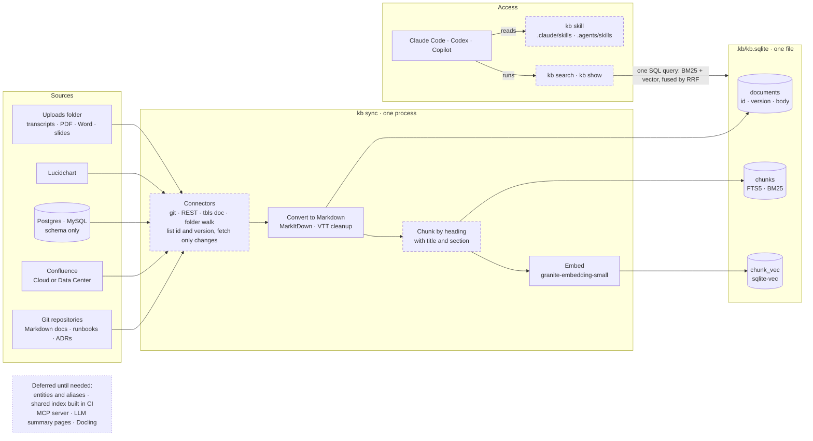
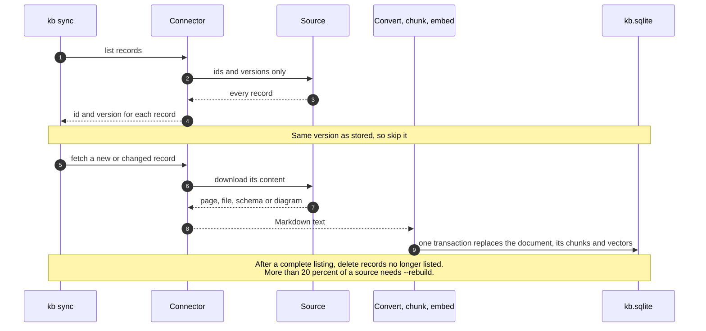
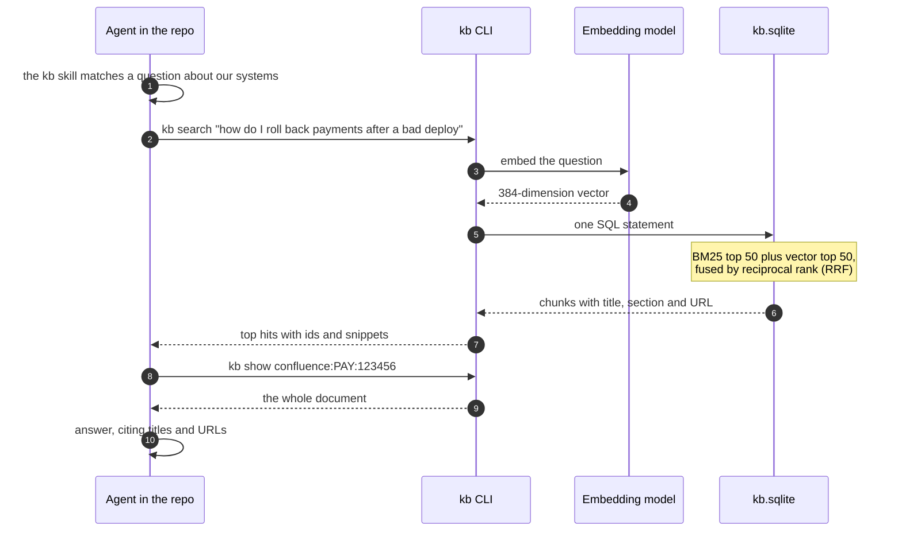
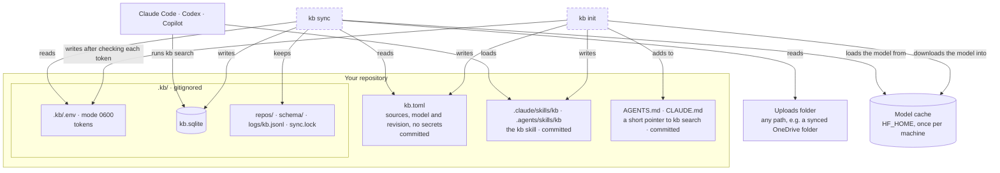

# Knowledge base architecture

*2026-11-04. These diagrams are drawn in Mermaid, which GitHub renders in place. The design behind them is in [design.md](design.md). The reasons for each component are in the [research report](../research/oss-landscape-2026-11.md) §16, which simplified the 2026-11-03 stack.*

Legend: a solid box is a reused open-source component or an external system, a dashed box is code we write, and a cylinder is stored data.

## 1. System

Five sources feed one command, `kb sync`, which writes one SQLite file. Agents read it by running `kb search`, which a skill tells them to do. There is no server.

Code itself is not indexed. Agents search the code they work in with their own tools, and other repositories contribute only their docs.

## 2. One sync run, for one record

Every connector lists the id and version of every record. A record whose version matches the stored one is skipped without being fetched. A record that is no longer listed is deleted, but only after a complete listing.

## 3. One question, end to end

The question is embedded with the same model that embedded the chunks. One SQL statement then fuses the keyword and vector results by rank.

## 4. What `kb init` sets up in a repository

Configuration that is safe to share, and the skill, are committed. Tokens, the index and logs stay in the gitignored `.kb/` folder. The embedding model is cached once per machine, and the uploads folder can be anywhere.

