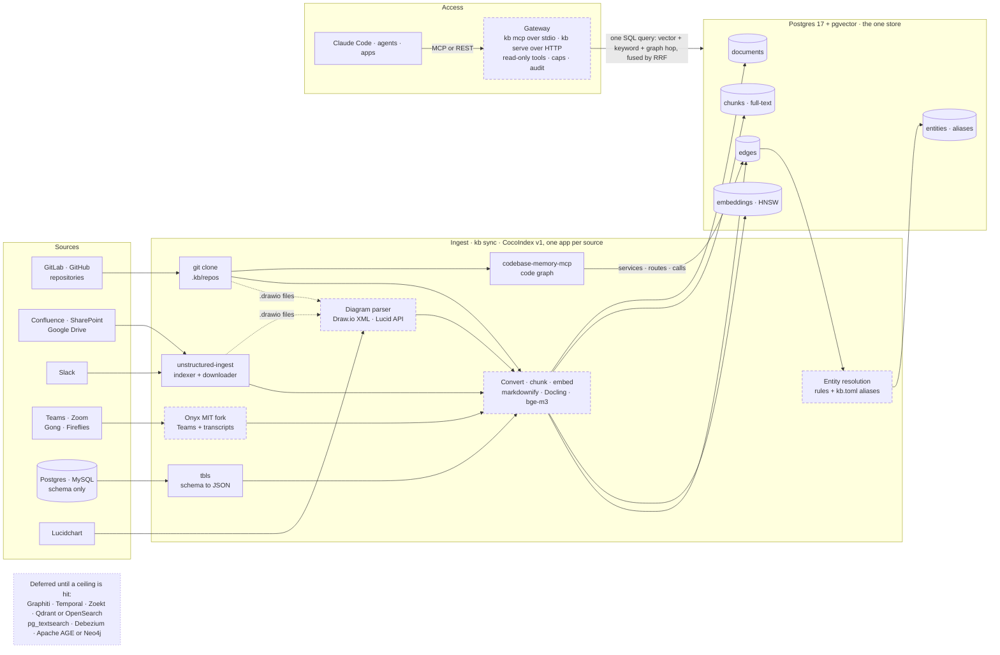
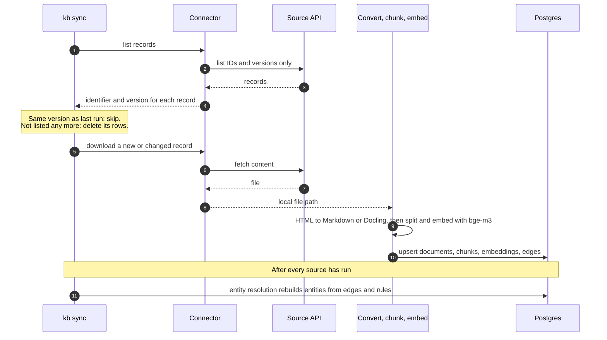
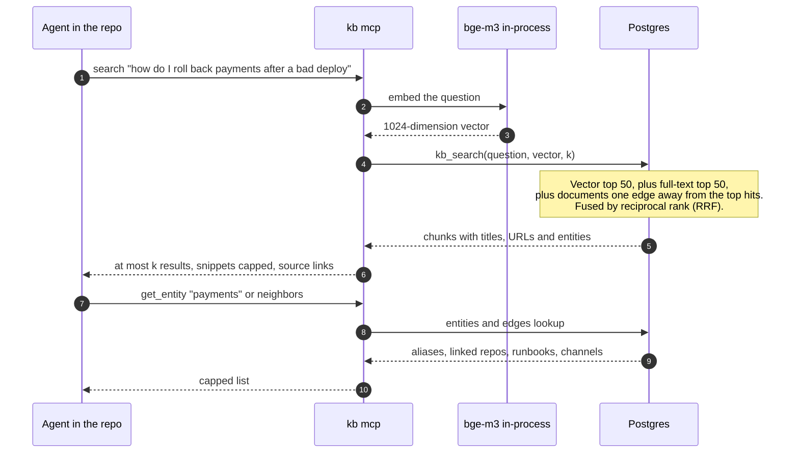
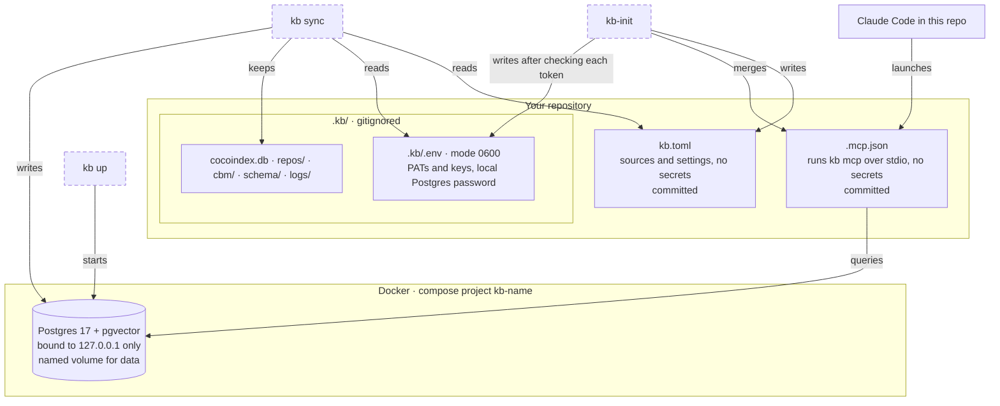

# Knowledge base architecture

> **Full design of 2026-11-03, kept for reference.** For v1 it is superseded by the simplified design in [../design.md](../design.md). What was removed and why is in [../decisions.md](../decisions.md) and [../design.md](../design.md) §2. Use this document when a deferred item comes back.

*2026-11-03. These diagrams are drawn in Mermaid, which GitHub renders in place. The design behind them is in [design.md](design.md), and the reasons for each component are in the [research report](../../research/oss-landscape-2026-11.md), §12–15. A hand-drawn version of the first diagram is in [research/architecture.html](../../research/architecture.html).*

Legend: a solid box is a reused open-source component, a dashed box is code we write or fork, and a cylinder is a Postgres table.

## 1. System

Every source feeds one sync process, `kb sync`, and that process writes to one Postgres. Agents read the knowledge base through one read-only gateway.

Draw.io has no source of its own: `.drawio` files are picked up wherever they already live, in git repositories and on Drive. Code is not embedded. codebase-memory-mcp keeps its own per-repository index, and only its services, routes and calls are exported into `edges`.

## 2. One sync run, for one record

CocoIndex v1 runs one processing component per source record. It remembers each component's key, `(identifier, version)`, so a record whose version has not changed is skipped without being downloaded. A record that is no longer listed is not mounted, and CocoIndex deletes the rows it produced.

## 3. One question, end to end

The gateway embeds the question with the same model that embedded the documents. It then runs one SQL function that unions three candidate lists and fuses them by rank.

## 4. What `kb-init` sets up in a repository

`kb-init` turns the repository it runs in into a knowledge-base project. Configuration that is safe to share is committed. Secrets and local state go under the gitignored `.kb/` folder, and Postgres runs in Docker.

